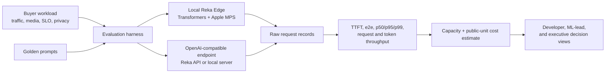

# Reka Edge Inference Lab


A buyer-facing multimodal inference evaluation: local Reka Edge on Apple Silicon, OpenAI-compatible endpoint load tests, raw latency/throughput evidence, dated public-unit costs, and a capacity/discovery report.

> Unofficial portfolio project. It is not a Reka product and is not affiliated with or endorsed by Reka.

## Review the complete offline path

```bash
uv sync --locked
uv run python -m unittest discover -s tests -v
uv run reka-infer demo --output artifacts/demo
uv run reka-infer verify artifacts/demo
open artifacts/demo/decision_report.html
```

This path needs no API key, model download, GPU, or private data. It generates:

```text
artifacts/demo/
├── benchmark.json              # raw request records + derived percentiles
├── concurrency_sweep.json      # 1/2/4/8 comparison with raw records per level
├── capacity_plan.json          # workload, dated prices, assumptions, exclusions
├── decision_report.md          # technical-review narrative
├── decision_report.html        # executive decision view
└── owned_multimodal_card.png   # original, deterministic evaluation media
```

The offline benchmark is intentionally labeled `simulated`. It proves that the evidence pipeline works; it makes no model-performance claim.

## What this project proves



- **Discovery discipline:** the workload schema makes request rate, burst, media, token size, SLO, utilization, privacy, and deployment assumptions explicit.
- **Inference measurement:** every summary derives from raw request records; averages never replace p95/p99 evidence.
- **Integration:** the endpoint client uses the standard streaming `/v1/chat/completions` contract and supports bearer or `X-Api-Key` authentication.
- **Local deployment:** the opt-in runner loads a pinned Reka Edge revision through Transformers, converts it to float16, moves it to Apple MPS, and records model/tokenizer timing evidence.
- **Commercial translation:** the same evidence produces a dated cost estimate, an abstract capacity-unit estimate, discovery questions, exclusions, and an explicit enterprise-quote boundary.

## Evidence classes

| Label | Meaning | Permitted conclusion |
|---|---|---|
| `simulated` | Transparent deterministic scheduling values | The analysis and reporting pipeline executes correctly |
| `observed-endpoint` | Client-side timings from one endpoint/configuration | This client observed these results under the recorded test |
| `observed-local` | Pinned model executed on the reported Mac/configuration | The exact local model path ran on that machine |
| `vendor-reported` | A claim linked to its original vendor source | The vendor reports the result; this project did not reproduce it |

The verifier fails if the benchmark and report disagree about their evidence class.

## Run the pinned Reka Edge model on macOS

Reka documents a Transformers/MPS path for Apple Silicon. The public model card recommends macOS 13+, Python 3.12+, and at least 32 GB unified memory. The float16 weights require roughly 14 GB before runtime headroom. ([Reka quickstart](https://docs.reka.ai/quickstart), [model card](https://huggingface.co/RekaAI/reka-edge-2603))

```bash
uv sync --locked --group local
uv run reka-infer probe

uv run reka-infer local \
  --create-demo-image \
  --accept-model-license \
  --output artifacts/local_reka_edge.json
```

The runner pins:

```text
model:    RekaAI/reka-edge-2603
revision: 492c81c225fbf5f3263a8245b00827721b119a13
runtime:  transformers==4.57.3, torch float16, device=mps
```

The first run downloads approximately 14 GB of weights and executes repository-supplied remote model code. Read the pinned files and the [Reka Edge license](https://huggingface.co/RekaAI/reka-edge-2603/blob/main/LICENSE) first.

A privacy-reduced [observed macOS smoke-test record](evidence/observed_local_smoke_2026-08-04.json) is included. It proves one successful pinned-model execution on the reported Mac; it is deliberately not presented as production-performance evidence.

### License boundary

The code in this repository is MIT licensed. The model is not. Reka Edge 2603 uses Business Source License 1.1 with additional restrictions before its change date, including production, hosted-service, public-sector, and $1 million annual-revenue conditions. The command requires `--accept-model-license`; that flag records acknowledgement, not legal advice or a new license grant. Model weights are never redistributed or tracked here.

### Serving boundary

The macOS command uses Transformers with Apple MPS. It does **not** run Reka's `vllm-reka` server. Reka documents `vllm-reka` as a separate Linux/CUDA high-throughput serving path. The OpenAI-compatible client in this project can target either kind of endpoint without changing the workload or reporting contract.

## Benchmark a Reka or compatible endpoint

API keys are read from the environment and are never accepted as command-line values:

```bash
export REKA_API_KEY="your-key"

uv run reka-infer endpoint \
  --base-url https://api.reka.ai \
  --model reka-edge \
  --requests 12 \
  --concurrency 2 \
  --output artifacts/reka_api
```

For a local OpenAI-compatible server:

```bash
uv run reka-infer endpoint \
  --base-url http://127.0.0.1:8000 \
  --model reka-edge-2603 \
  --provider-name local-server \
  --requests 20 \
  --concurrency 4 \
  --output artifacts/local_server
```

The client records provider failures such as 429s as evidence instead of dropping them. When an endpoint omits token usage, the output count is visibly labeled `estimated`; capacity decisions should use provider or model-tokenizer counts when available.

### Sweep concurrency with excluded warm-up evidence

```bash
uv run reka-infer sweep \
  --base-url https://api.reka.ai \
  --model reka-edge \
  --levels 1,2,4 \
  --requests-per-level 12 \
  --warmup-requests 1 \
  --output artifacts/reka_concurrency_sweep.json
```

Each level preserves its measured raw records, success/error counts, TTFT, end-to-end latency, request throughput, and token throughput. Warm-up requests are also retained, but they are explicitly excluded from the measured summary. This makes queueing and tail-latency changes visible without silently discarding failed preparation traffic.

## How to read the metrics

| Metric | What it means | Why it changes a deal |
|---|---|---|
| TTFT | Time until the first streamed output arrives | Governs perceived responsiveness |
| End-to-end latency | Time until the complete response is available | Governs task completion and downstream workflow time |
| Inter-token latency | Generation time after first token divided across output tokens | Separates queue/prefill delay from decoding speed |
| Request throughput | Successful requests divided by wall time | Describes task capacity for the tested mix |
| Output throughput | Output tokens divided by wall time | Describes generation capacity for the tested mix |
| p95 / p99 | Tail latency exceeded by 5% / 1% of successful requests | Exposes variability hidden by a mean |

No metric is portable without the model revision, hardware/endpoint, prompt and media mix, output length, concurrency, warm-up state, and error policy.

## Capacity and cost boundary

The planner treats the tested endpoint/configuration as one **abstract capacity unit**. It calculates the number of equivalent units required by both request demand and output-token demand at the chosen utilization target. It does not translate that unit into a GPU because hosted services do not expose a stable one-endpoint-to-one-GPU relationship.

The example price file is dated August 4, 2026 and links the current public sources. It combines Reka Edge Chat token units with Reka Vision indexing/search units for the demonstration workload. It excludes retries, unrepresented storage, engineering, taxes, discounts, private endpoints, and dedicated capacity. Those exclusions remain in the machine-readable plan and the report says `quote required` for enterprise capacity.

## Executable reviewer notebook

Open [the workload-to-decision tutorial](notebooks/01_workload_to_decision.ipynb), or run it headlessly:

```bash
uv sync --locked --group notebook
uv run --group notebook jupyter nbconvert \
  --to notebook --execute notebooks/01_workload_to_decision.ipynb --stdout > /dev/null
```

The notebook loads the real configuration files, creates deterministic request evidence, derives the capacity plan, verifies the report bundle, and runs the repository tests. It does not download or call a model.

## Repository map

```text
.
├── .github/                    # public Linux release gate + dependency updates
├── evidence/                   # privacy-reduced observed local smoke record
├── examples/                   # workload, prompts, and dated public prices
├── notebooks/                  # executable buyer-evaluation walkthrough
├── scripts/verify_artifacts.py
├── src/reka_inference_lab/
│   ├── benchmark.py            # simulation + streaming endpoint client
│   ├── capacity.py             # bounded demand and cost translation
│   ├── local_edge.py           # pinned Transformers/MPS execution
│   ├── report.py               # Markdown and HTML views
│   ├── artifacts.py            # fail-closed evidence verifier
│   └── models.py               # validated data contracts
├── tests/
├── MODEL_CARD.md
├── SOURCES.md
├── VERIFICATION.md
├── pyproject.toml
└── uv.lock
```

## Verification

```bash
uv sync --locked --group dev --group notebook
uv run ruff check .
uv run ruff format --check .
uv run python -m unittest discover -s tests -v
uv run --group notebook jupyter nbconvert --to notebook --execute notebooks/01_workload_to_decision.ipynb --stdout > /dev/null
uv run reka-infer demo --output artifacts/demo
uv run reka-infer verify artifacts/demo
```

See [VERIFICATION.md](VERIFICATION.md) for recorded macOS and clean-checkout results, [MODEL_CARD.md](MODEL_CARD.md) for claim boundaries, and [SOURCES.md](SOURCES.md) for design lineage.

## Security

- Secrets remain in environment variables and are never written to reports.
- Endpoint errors are recorded, but authentication headers are not.
- The local model revision is pinned because `trust_remote_code=True` executes model-repository Python.
- Generated media and result bundles are ignored by Git; inspect them before sharing because real endpoint output may contain prompt or business data.
- Joblib, pickle, browser automation, and shell-configuration edits are not part of this project.

## License

Original repository code: [MIT](LICENSE). Reka model files: separate [Reka Edge license](https://huggingface.co/RekaAI/reka-edge-2603/blob/main/LICENSE).
